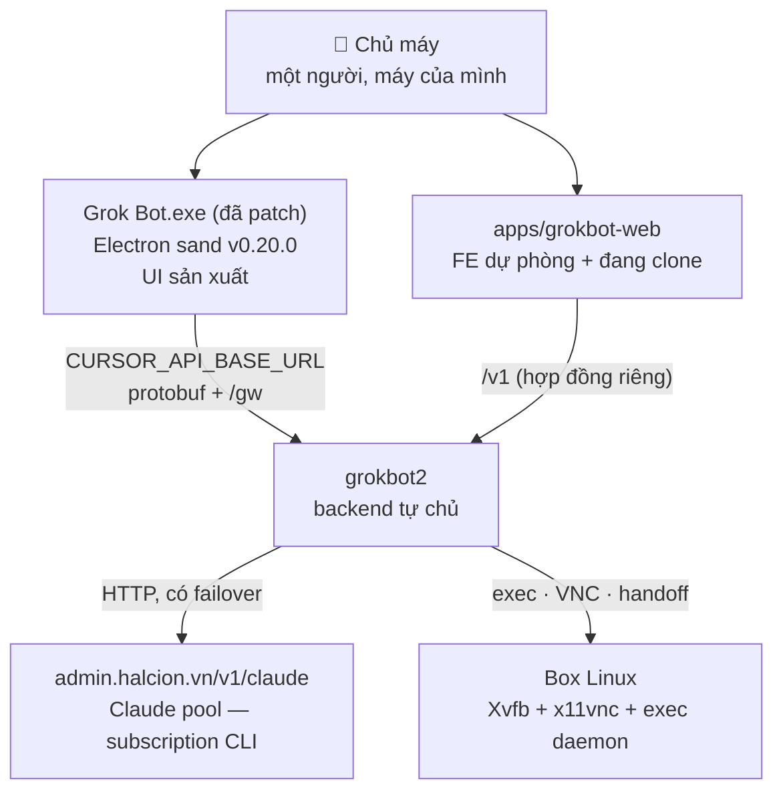
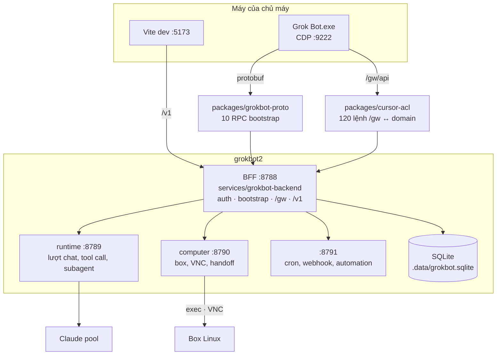
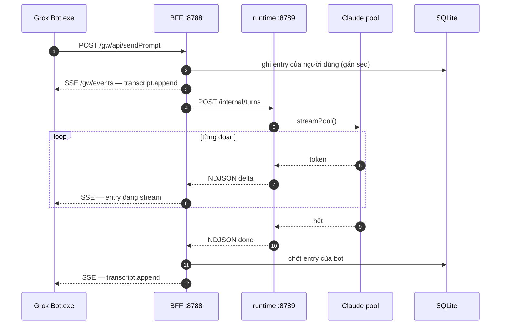
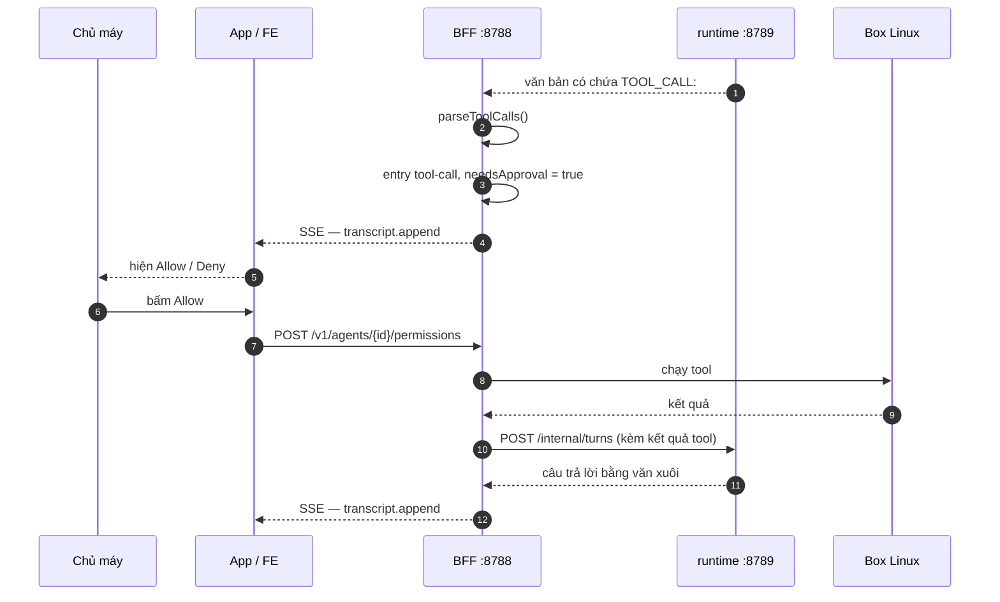
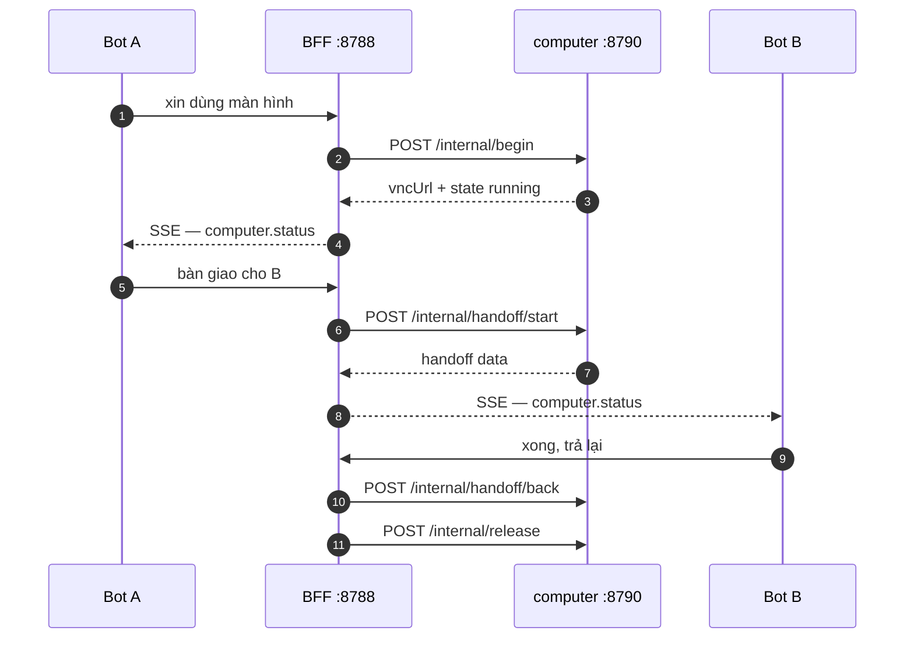
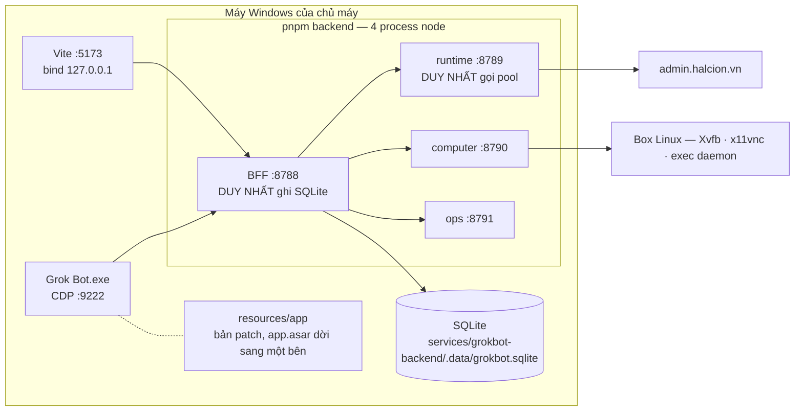

# Architecture

Sơ đồ theo **C4** (Simon Brown), chỉ mức 1 và 2 — mức 3 khi cần, mức 4 bỏ. Viết bằng Mermaid ngay
trong file này chứ không dùng công cụ vẽ ngoài: sơ đồ rẻ để dựng lại thì mới không mục. Quyết định
*vì sao* nằm ở [adr/](adr/README.md).

> Đường đi của một NGƯỜI DÙNG — vào bằng cửa nào, cài ra sao, tiền tính thế nào, dữ liệu ở đâu —
> nằm ở [plan/ship-to-users.md](plan/ship-to-users.md). Tài liệu này là cấu trúc hệ thống; tài liệu
> kia là hành trình người dùng và kế hoạch A→Z.

## C4 mức 1 — System Context

Ai dùng hệ thống, và hệ thống dựa vào cái gì bên ngoài.



Hai điều đọc ra được ngay từ sơ đồ này, và cả hai đều là quyết định chứ không phải tình cờ:
**hai FE nói hai hợp đồng khác nhau** (app hãng nói protobuf + `/gw`, FE của mình nói `/v1`), và
**pool là phụ thuộc ngoài duy nhất** — hỏng nó thì chat chết, mọi thứ khác vẫn sống.

## C4 mức 2 — Container

Bốn process, một FE, một file dữ liệu. Cổng là phần quan trọng: mỗi process một cổng, không dùng chung.



`cursor-acl` và `grokbot-proto` là **lõi vĩnh viễn**, không phải adapter tạm — đảo hướng
2026-08-20 làm chúng thành đường sản xuất duy nhất của app hãng. Mọi comment nào nói "Phase 8 xoá
ACL" đều đã hết hiệu lực (`ROADMAP.md` §0.2).

Vì sao **tách bốn process** mà không một khối: gate của phase P4–P6 đòi chứng minh từng phần chết
riêng được — `e2e-runtime-down`, `e2e-computer-down`, `e2e-ops-down` là ba bài kiểm đúng điều đó.
BFF chết thì mất hết; ba cái kia chết thì chỉ mất phần của nó.

## Ba luồng quan trọng (C4 dynamic)

Ba luồng này chọn vì chúng là ba chỗ đã từng hỏng và khó chẩn đoán. Tên trong sơ đồ là tên **thật**
trong code, không phải nhãn cho đẹp — tra được bằng `grep`.

### 1. Gửi một tin



Hai điều đọc ra được, và cả hai là quyết định:

- **`seq` không bao giờ sinh ở `runtime`.** BFF giữ thứ tự transcript (`docs/parity.md` §2ac). Nếu
  runtime tự đánh số thì client — vốn giữ một bản sao có thứ tự — sẽ thấy hai nguồn số va nhau.
- **`runtime` là process duy nhất nói với pool.** Nên "pool chết" chỉ làm chết một process, và
  `e2e-runtime-down.mjs` kiểm đúng điều đó.

### 2. Tool call cần xin phép



`needsApproval` do bảng tool quyết định (`src/tools.ts`), không do model. Model chỉ *đề nghị*;
quyền là của chủ máy.

Chỗ này từng hỏng đúng một kiểu: khi người dùng bấm dừng giữa lượt, `TOOL_CALL:` **thô** lọt vào
transcript và hiện ra như văn bản. Gate có một bước riêng cho nó — *"the turn ends with a prose
answer, not raw TOOL_CALL"*.

### 3. Bàn giao màn hình (handoff)



Phân vai cố ý: **`computer` giữ *dữ liệu* handoff và biết ai đang chiếm màn hình; BFF giữ *Promise*
và bộ đếm nhả màn hình.** Ghi rõ ở đầu `services/grokbot-computer/src/index.ts`. Trộn hai thứ vào
một chỗ thì lúc process kia chết sẽ treo vô hạn — `e2e-computer-down.mjs` là bài kiểm cho điều đó.

## Triển khai — process nào nghe cổng nào, ai ghi dữ liệu



Bốn điều bất biến đáng nhớ, vì mỗi cái đã từng là một sự cố:

| Bất biến | Sai thì sao | Runbook |
|---|---|---|
| **Chỉ BFF ghi SQLite** | hai process ghi cùng lúc thì `seq` va nhau | — |
| Mỗi process **một cổng riêng**, 8788–8791 | tiến trình rò rỉ chiếm cổng và chạy dữ liệu fixture | [runbooks/wrong-bots-in-roster.md](runbooks/wrong-bots-in-roster.md) |
| Vite bind **`127.0.0.1`**, không phải `localhost` | trên Windows `localhost` ra `::1` trước, `127.0.0.1` bị từ chối | [runbooks/ipv4-refused.md](runbooks/ipv4-refused.md) |
| App boot từ **`resources/app`**, `app.asar` phải dời sang một bên | `app.asar` thắng thứ tự nạp → boot bản hãng, patch vô tác dụng | [runbooks/patch-half-applied.md](runbooks/patch-half-applied.md) |

## The seam

The Grok Bot desktop app (Electron) resolves its backend base URL from:

```js
new URL(process.env.SAND_BACKEND_URL ?? process.env.CURSOR_API_BASE_URL ?? "https://api2.cursor.sh")
```

Setting `CURSOR_API_BASE_URL=http://localhost:8788` routes **all** backend traffic to this
backend. There is no TLS pinning or response signing that blocks a localhost server;
`x-cursor-checksum` is an outbound-only header the server can ignore.

## Request flow

```
Grok Bot desktop (Electron, unchanged)
   │  CURSOR_API_BASE_URL → http://localhost:8788
   ▼
grokbot-backend
   ├─ /oauth/token, /auth/*          → mint JWT (auth.ts)
   ├─ /aiserver.v1.*/<method>        → protobuf gate responses (@grokbot2/proto)
   ├─ /gw/health, /gw/events (SSE)   → box "healthy" so the window shows (gateway.ts)
   ├─ /gw/api/<method>               → JSON host/agent methods (gateway.ts)
   │     └─ sendPrompt               → chat.ts → @grokbot2/pool-client
   ▼
admin.halcion.vn/v1/claude  (your Claude pool: subscription CLI, LB + failover)
```

## Why the app is a thin client

The desktop app is architected as a viewer onto a cloud **box** (a Linux sandbox pod):
`EnsureSandBox` returns `cluster / pod_id / vnc_url / gateway_url / exec_daemon_url`. The
workspace pane is a VNC stream of that Linux desktop (`Xvfb + x11vnc + websockify + xfwm4`).

For **chat**, we stub the box: `EnsureSandBox` points the gateway at this backend, and the
gateway serves healthy JSON so the window renders. Chat is implemented directly in the
gateway (the box's agent host role), backed by the Claude pool.

For a **working workspace/VNC**, run a real box — see [roadmap.md](../ROADMAP.md).

## Layers in this repo

- **auth.ts** — JWT minting + `/oauth/token`. The client decodes but never verifies the sig.
- **@grokbot2/proto** — a tiny protobuf wire encoder + the bootstrap gate responses (field
  numbers/enums extracted from the client bundle; see [protocol-reference.md](protocol-reference.md)).
- **gateway.ts** — the `/gw/*` box-host API as JSON + an SSE event channel.
- **chat.ts** — an in-memory transcript store; `sendPrompt` calls the pool and appends the reply.
- **@grokbot2/pool-client** — the HTTP client for the OpenClaw Claude pool.
