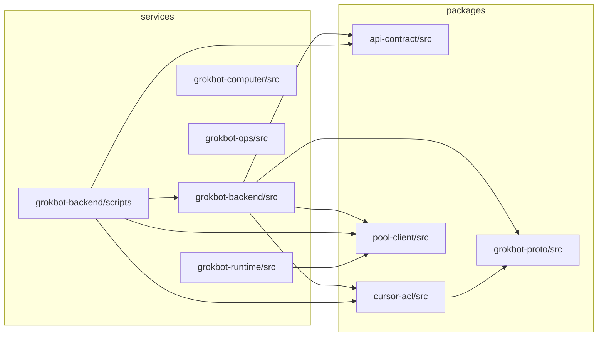

# Sơ đồ do MÁY vẽ — không sửa tay

> Sinh lại: `pnpm arch:graph` (phụ thuộc giữa gói) · `npx turbo run build --graph=docs/architecture/turbo-graph.mermaid` (thứ tự dựng)
> Kiểm luật: `pnpm arch:check`

Hai sơ đồ dưới đây đọc từ **import thật trong mã**, không phải từ trí nhớ ai. Sửa tay là vô nghĩa —
lần chạy `arch:graph` kế tiếp ghi đè.

Vì sao cần: `architecture.md` sửa lần cuối 25/08, `coupling-inventory.md` 22/08, còn
`services/grokbot-backend/src` sửa **hôm nay**. Sơ đồ vẽ tay trễ 6–9 ngày so với thứ đang chạy —
đúng cái bệnh `trang-thai.mjs` đã chẩn cho tài liệu trạng thái, chỉ là chưa ai áp cho sơ đồ.

---

## 1 · Phụ thuộc giữa các gói

Ai gọi ai. Gom về cấp thư mục (`--collapse 3`) — cấp file thì đúng nhưng 1.671 dòng, không ai nhìn nổi.

Đọc ra được ba điều, và cả ba đều là ràng buộc thật:

- **`cursor-acl` không gọi ngược `services/`.** Đó là cả lý do nó tồn tại — lớp chống nhiễm, mọi
  thứ biết tên lệnh Cursor sống trong đó, gọi ra ngoài chỉ qua `ports.ts`. Nay là **luật máy đỏ
  được**, không còn là lời hứa trong tài liệu.
- **`grokbot-proto` là lá.** Nó chỉ mã hoá/giải mã, không biết gì về backend lẫn ACL.
- **`scripts/` gọi thẳng vào `src/`** của backend. Đúng bản chất — chúng là công cụ đo, không phải
  mã chạy.

Bản đầy đủ (mọi cạnh): [`so-do-phu-thuoc.mermaid`](so-do-phu-thuoc.mermaid).

> **Một cái bẫy đã suýt làm sơ đồ này nói dối.** Mỗi gói workspace khai `main: "dist/index.js"`, mà
> `dist` bị loại khỏi sơ đồ. Bản vẽ đầu vì thế **mất hẳn** cạnh `backend → cursor-acl`, trông như
> backend không dùng lớp chống nhiễm — trong khi `gateway.ts:10` import nó. Chữa bằng
> `tsconfig.depcruise.json` trỏ gói về `src`. Một sơ đồ thiếu đúng cạnh quan trọng nhất còn tệ hơn
> không có sơ đồ, vì nó trông đáng tin.

## 2 · Thứ tự dựng

Turbo tính từ `dependsOn` trong `turbo.json` — miễn phí, không thêm gói nào.

Xem: [`turbo-graph.mermaid`](turbo-graph.mermaid).

## 3 · Luật kiến trúc máy kiểm được

`pnpm arch:check` — hiện **0 vi phạm** trên 383 module, 563 phụ thuộc.

| luật | ý nghĩa |
|---|---|
| `acl-khong-goi-nguoc-backend` | `cursor-acl` không được import `services/` |
| `proto-khong-goi-nguoc` | `grokbot-proto` không biết backend lẫn ACL |
| `khong-vong-tron` | không import vòng |
| `khong-import-file-khong-ton-tai` | đường dẫn giải được (trừ `@electron/asar`, cố ý dùng qua `npx`) |
| `khong-dung-devDependency-trong-ma-chay` | máy dev chạy được thì máy cài từ bộ cài cũng phải chạy được |

Luật nằm trong [`.dependency-cruiser.cjs`](../../.dependency-cruiser.cjs), mỗi luật kèm lý do nó tồn
tại. Thêm luật mới thì viết lý do — một luật không ai nhớ vì sao có là luật sẽ bị tắt vào lần đầu
nó cản đường.
