# Tách theo người dùng trên cùng một box

Trạng thái: kế hoạch, chưa làm. **Có một chỗ chặn cần quyền root, đo được ở dưới** — phần code
sau đó nhỏ.

Đọc cùng: [one-display-per-bot.md](one-display-per-bot.md) (tách màn hình theo bot — tầng dưới của
kế hoạch này) và [desktop-computer-use.md](desktop-computer-use.md).

## Vì sao

Hôm nay mọi bot, và do đó mọi người dùng, chạy dưới **một OS user duy nhất** trên box. Đo trực tiếp:

```
uid=1001(box) gid=1001(box)          ← mọi bot
ls /root → Permission denied          ← có tường với HỆ ĐIỀU HÀNH
```

Tường với hệ điều hành thì có. Tường **giữa những người dùng** thì không tồn tại:

| chung cái gì | hậu quả |
|---|---|
| `/home/box/.config/grok-chrome-77` (3.7 GB) | **cookie và phiên đăng nhập Shopee/Facebook dùng chung** |
| `/home/box/grok-memory/agent-*.json` | bot của người này đọc được **trí nhớ** bot người khác |
| `/home/box/workspace` | mọi báo cáo, khoá API, file bot viết ra đều đọc chéo |

Cơ sở dữ liệu trên máy Windows **đã tách theo owner** (bot, hội thoại, routine đều có `owner_id`).
Box thì chưa. Nên: **một người dùng thì ổn; người thứ hai là rò hoàn toàn.**

Và cái khoá `claimDesktop` không cứu được chuyện này — nó chỉ ngăn hai bot bấm chuột cùng lúc.

## Bản gốc cô lập kiểu gì — đọc từ host của họ

Thêm 25/08/2026, sau khi đọc `dist/host/` trong bundle client. **Phần này sửa một giả định của
chính tài liệu này**: mục "Mô hình" bên dưới từng nói hai tầng là "đúng như bản gốc làm". Nói vậy
là chưa đúng — hãng không tách theo OS user ở đâu cả.

### Đo được gì

Bundle client **có chứa host của hãng**: `dist/host/host-main.cjs` — **11,9 MB**, có `express` +
`sqlite`, phục vụ `createAgentTurn` / `EnsureSandBox`. Bên trong nó có một hợp đồng cô lập đầy đủ:

| kiểu `agent.v1` | các trường |
|---|---|
| **`SandboxPolicy`** | `type` · `network_access` · `additional_readwrite_paths` · `additional_readonly_paths` · `disable_tmp_write` · `allowlist_escalated` · `enable_shared_build_cache` · `network_policy` · `network_policy_strict` |
| **`NetworkPolicy`** | `version` · `default_action` · `deny` · `allow` · `logging` |
| từ chối theo năng lực | `ShellPermissionDenied` · `EditReadPermissionDenied` · `EditWritePermissionDenied` · `DeletePermissionDenied` · `McpPermissionDenied` · `DiagnosticsPermissionDenied` |
| khi không cô lập được | `ShellSandboxUnsupported` |

Kiểu chính sách thấy trong mã: `workspace_readwrite` · `workspace_readonly` · `readonly` ·
`insecure_none`.

**Cưỡng chế bằng một tiến trình phụ**, gọi đúng dạng này (rút từ `electron-main/main.cjs`):

```
<helper> --policy <base64 JSON> --preflight-only -- /bin/true
```

Và họ **thử trước rồi mới tin** — `isSandboxHelperSupported` chạy preflight thật trên Linux. Phán
quyết theo hệ, ghi thẳng trong log của họ:

| hệ | kết quả |
|---|---|
| Windows | `proxy-only, no filesystem sandbox` → **false**, tự nhận không cô lập được file |
| macOS | có, nếu binary có mặt |
| Linux | chạy preflight thật, đúng thì mới bật |

`dist/host/agent-isolation/` hoá ra **không** phải cô lập người dùng: hai worker
`agent-store-worker` (bảng `blobs`) + `transcript-mirror-worker` — tức là **tách dữ liệu theo
agent**.

### Kết luận — và chỗ tài liệu này từng sai

**Hãng không cô lập người dùng bên trong box. Ranh giới giữa người với người của họ CHÍNH LÀ cái
box** — cloud cấp mỗi người một cái. Sandbox trong box bảo vệ **box khỏi chính con bot**, không bảo
vệ người A khỏi người B.

Ba hệ quả cho kế hoạch này:

1. **Không có đường tắt nào để mượn.** Bài toán "nhiều người chung một box" là bài toán hãng không
   có, nên trong bundle không có lời giải. Phần tách OS user ở dưới **vẫn phải tự làm**, đúng như
   đã viết.
2. **Nhưng hợp đồng thì mượn được, và nên mượn.** `additional_readwrite_paths` chính là allowlist
   theo người mà kế hoạch này phác ra; `NetworkPolicy` là phần chặn đường ra. Dùng lại **hình dạng**
   của họ đáng giá vì client đã nói `agent.v1` sẵn — và vì một hợp đồng đã chạy thật ngoài đời thì
   hơn một hợp đồng mình vừa nghĩ ra.
3. **Phần cưỡng chế thì không mượn được.** Binary helper **không nằm trong bộ cài** — đã tìm khắp
   thư mục cài, không có file nào. Trên Linux nhiều khả năng do ảnh box của họ cung cấp.

Nên hình dạng đúng là **ba tầng**, không phải hai:

| tầng | ai lo | chống được gì |
|---|---|---|
| **OS user** (`gb2u001`…) | mình tự làm — phần còn lại của tài liệu này | người A đọc file người B |
| **Chính sách theo lệnh** (`SandboxPolicy`) | mượn hình dạng của hãng, tự cưỡng chế | bot tự phá box, hoặc đi ra ngoài chỗ không nên |
| **Kho dữ liệu theo agent** | đã có (`owner_id` trong SQLite) | bot này đọc hội thoại bot kia |

**KHÔNG CHẮC CHẮN:** tên và nguồn của binary helper — hàm trả về đường dẫn đã bị minify thành một
biến chưa truy ra. Muốn dùng lại đúng cách thì phải truy tiếp, hoặc tự viết phần cưỡng chế bằng
`bwrap`/`landlock` và chỉ giữ lại hình dạng chính sách.

## Đã tách tới đâu rồi — đo trên kho thật

Trước khi bàn tách thêm, phải biết cái gì **đã** tách. Đo bằng schema SQLite và bằng số lần code
gọi tới phạm vi owner:

### Mặt dữ liệu (SQLite trên máy Windows) — **đã tách**

| bảng | có `owner_id`? | số dòng |
|---|---|---|
| `agents` · `entries` · `parked` · `automations` | ✅ | 8 · 2036 · 19 · 8 |
| `attachments_meta` · `acceptance` · `todos` | ✅ | 64 · 1371 · 1 |
| `handoffs` · `compaction` | ✅ | 2 · 8 |
| `users` · `usage` | khoá theo `auth_id` | 1 · 0 |
| `plans` | toàn cục **đúng thiết kế** (bảng giá chung) | 0 |
| `host_settings` | ❌ **một dòng cho tất cả** | 1 |

Mười bảng chứa dữ liệu người dùng đều có `owner_id`, và code đọc chúng qua `currentOwner()` /
`ownerOf(agentId)` / `runWithOwner()` ở 10 module: `chat/state`, `directory`, `gateway`, `index`,
`mcp`, `native`, `plugins`, `request-context`, `runtime/tools`, `runtime/turn`.

**Một lỗ hổng thật ngay trong bảng: `host_settings`.** Cài đặt (múi giờ, quyền công cụ mặc định) là
**một dòng dùng chung** — người này đổi thì người kia chịu.

### Mặt box — **chưa tách gì cả**

Số lần các module này nhắc tới phạm vi owner: **0**.

| module | lưu ở đâu | ai đọc được |
|---|---|---|
| `memory.ts` | `/home/box/grok-memory/agent-*.json` | mọi bot của mọi người |
| `skills.ts` | `.claude/skills` … trên box | mọi bot |
| `displays.ts` · `desktop.ts` · `teach.ts` | X display + `/tmp/grokbot2` | mọi bot |
| Chrome | `.config/grok-chrome-77` (3.7 GB) | **cookie chung** |

Trí nhớ bot *khoá theo `agentId`*, và agent thì có owner — nên về mặt LOGIC nó đã thuộc về ai đó.
Nhưng **file thì nằm chung một thư mục và ai cũng đọc được**, nên cách ly logic không cứu được gì
khi bot có công cụ đọc file.

Nói gọn: **dữ liệu đã tách, máy thì chưa.** Kế hoạch này là phần "máy".

## Đã đo — và chỗ chặn

Trên chính box này, ngày 25/08/2026:

| câu hỏi | trả lời đo được |
|---|---|
| daemon chạy dưới user nào | `uid=1001(box)`, không phải root |
| có sudo không | **không** — `sudo: a password is required` |
| `useradd` / `runuser` / `setpriv` có sẵn? | ✅ `/usr/sbin/useradd`, `/usr/sbin/runuser`, `/usr/bin/setpriv` |
| chạy được lệnh dưới user khác? | ❌ `su ubuntu -c` không ra gì |
| `/home` cho ghi không | ❌ `755 root` |
| có phải container không | không thấy `/.dockerenv`; cgroup `/init.scope` → VM |
| RAM / CPU / đĩa | 22 GB (còn ~8 GB) · 19 nhân · còn 37 GB |

**Kết luận thẳng: không thể tách theo OS user từ bên trong daemon hiện tại.** Công cụ có đủ, quyền
thì không. Đây không phải chỗ để lách — không có uid thứ hai thì không có cách ly nào cả, vì quyền
file của Linux không ngăn một user đọc file của chính nó.

## Bước 0 — một lần root, do người quản trị VPS làm

Đây là toàn bộ phần cần quyền cao, làm một lần:

```bash
# 1. Nhóm chứa người dùng grokbot2
groupadd -f gb2users

# 2. Cho daemon (user `box`) chạy lệnh DƯỚI DANH NGHĨA những user đó — và chỉ thế
cat >/etc/sudoers.d/grokbot2 <<'EOF'
box ALL=(%gb2users) NOPASSWD: ALL
box ALL=(root) NOPASSWD: /usr/sbin/useradd, /usr/sbin/userdel, /usr/bin/install
EOF
chmod 440 /etc/sudoers.d/grokbot2
```

Dòng thứ hai là chỗ đáng cân nhắc kỹ: nó cho daemon **tạo và xoá user**. Ai không muốn vậy thì bỏ
dòng đó và tạo sẵn một dải user (`gb2u001`…`gb2u100`) bằng tay; backend chỉ mượn, không tạo.

**Đó là lựa chọn nên bàn trước khi viết code**, vì nó quyết định backend cần quyền tới đâu.

## Mô hình

Hai tầng dưới đây là **của mình**, không phải bắt chước hãng — xem mục trên: hãng lấy chính cái
box làm ranh giới giữa người với người, nên phần này không có bản mẫu để chép. Thứ mượn được của họ
là `ensureWindow(boxId, windowIndex)` với `ownerToken` riêng từng cửa sổ (xem
[one-display-per-bot.md](one-display-per-bot.md)) — đó là tách **bot**, không phải tách **người**:

```
box (một VPS)
├── gb2u001/                     ← một OS user cho MỘT người dùng grokbot2
│   ├── workspace/               ← file bot của họ
│   ├── grok-memory/             ← trí nhớ bot của họ
│   ├── .claude/skills/          ← skill của họ
│   └── .config/chrome-<bot>/    ← hồ sơ Chrome RIÊNG TỪNG BOT
│       └── display :5xx         ← một X display mỗi bot
└── gb2u002/  …
```

Cách ly do **quyền file của Linux** lo, không do code mình lo. Đó là điểm mạnh nhất của phương án
này: một lỗi trong backend không mở được file của user khác, vì kernel từ chối.

## Thu hồi khi nghỉ — chỗ quyết định chi phí

Đây là phần quan trọng nhất, và nó **không phải một cái công tắc mà là ba tầng**, thu dần theo thời
gian nhàn rỗi. Con số lấy từ đo thật:

| tầng | sau khi nghỉ | thu lại | còn giữ gì |
|---|---|---|---|
| 1. Chrome | **10 phút** | ~350–500 MB RAM | display + hồ sơ Chrome trên đĩa → mở lại **giữ nguyên đăng nhập**, ~3 giây |
| 2. Display (Xvfb + WM) | **30 phút** | ~50 MB RAM | hồ sơ trên đĩa → mở lại ~3 giây, vẫn đăng nhập |
| 3. Hồ sơ Chrome trên đĩa | **7 ngày** | ~350 MB đĩa **mỗi bot** | không gì — lần sau phải **đăng nhập lại** |

Ba lằn ranh này không phải tuỳ tiện:

- **Tầng 1 rẻ và đau ít.** Chrome là 90% chi phí RAM. Mở lại mất 3 giây (đo được ở
  `displays.ts`) và **không mất phiên đăng nhập**, nên thu sớm là đúng.
- **Tầng 2 tiết kiệm ít.** Xvfb chỉ ~30–45 MB (đo trên các display đang chạy của box). Thu nó chủ
  yếu để trả lại slot, không phải để trả lại RAM.
- **Tầng 3 mới là thứ đụng vào người dùng**, vì mất cookie là lần sau phải đăng nhập Shopee lại.
  Nên nó tính bằng **ngày**, không phải phút, và phải báo trước trong giao diện.

Cái quyết định hoá đơn là **tỉ lệ hoạt động đồng thời**, không phải số người đăng ký:

```
RAM khả dụng ÷ RAM mỗi người đang hoạt động = số người đồng thời
        8 GB ÷ 500 MB                        ≈ 14   (box hiện tại, còn 8 GB)
       56 GB ÷ 500 MB                        ≈ 112  (một VPS 64 GB)
```

Với tỉ lệ hoạt động 2–10% thường thấy, **112 chỗ đồng thời đỡ được cỡ 1.000–3.000 người đăng ký**.
Một máy, không phải một nghìn máy.

Đĩa mới là chỗ chật trước nếu quên tầng 3: 350 MB × 1000 bot = **350 GB**. Box hiện còn 37 GB.

**Một điều phải nói trước:** tầng 1 và 2 tự động được. Tầng 3 thì **không nên tự động im lặng** —
xoá hồ sơ là đăng xuất người ta khỏi Shopee. Phải hiện trong `/admin` và báo trước.

## Sơ đồ — hôm nay và sau khi tách

Hôm nay: mọi đường đều đổ về **một OS user**.

```mermaid
flowchart TB
  subgraph W["Máy Windows — ĐÃ tách theo owner"]
    A1["User A<br/>token"] --> GW["Gateway<br/>currentOwner()"]
    A2["User B<br/>token"] --> GW
    GW --> DB[("SQLite<br/>owner_id ✅")]
  end
  GW --> EX["box-exec<br/>MỘT token daemon"]
  subgraph BOX["Box VPS — CHƯA tách"]
    EX --> U["OS user: box (uid 1001)"]
    U --> WS["/workspace<br/>file của mọi người"]
    U --> MEM["grok-memory/<br/>trí nhớ mọi bot"]
    U --> CH["Chrome :77<br/>COOKIE CHUNG"]
  end
  style BOX fill:#3d1417,stroke:#6e2329
  style CH fill:#5a1d22,stroke:#a33
```



Sau khi tách: kernel giữ ranh giới, không phải code.

```mermaid
flowchart TB
  subgraph W["Máy Windows"]
    A1["User A"] --> GW["Gateway<br/>owner = A"]
    A2["User B"] --> GW2["Gateway<br/>owner = B"]
    GW --> DB[("SQLite owner_id")]
    GW2 --> DB
  end
  GW --> OU["os-users.ts<br/>owner → OS user"]
  GW2 --> OU
  OU -->|"runuser gb2u001"| UA
  OU -->|"runuser gb2u002"| UB
  subgraph BOX["Box VPS — một máy, nhiều user"]
    subgraph UA["gb2u001 (User A)"]
      WA["workspace/"] --- MA["grok-memory/"] --- SA[".claude/skills/"]
      DA1["bot A1 → :521 + Chrome riêng"]
      DA2["bot A2 → :522 + Chrome riêng"]
    end
    subgraph UB["gb2u002 (User B)"]
      WB["workspace/"] --- MB["grok-memory/"]
      DB1["bot B1 → :531 + Chrome riêng"]
    end
  end
  UA -. "kernel từ chối" .-x WB
  style UA fill:#0d2818,stroke:#2a6
  style UB fill:#0d1f2d,stroke:#268
```



Vòng đời và thu hồi — chỗ quyết định hoá đơn:

```mermaid
flowchart LR
  I["Người dùng gõ tin"] --> E{"đã có OS user?"}
  E -- chưa --> C["tạo gb2uNNN<br/>+ home"]
  E -- rồi --> D
  C --> D{"bot đã có display?"}
  D -- chưa --> S["Xvfb + WM + Chrome<br/>~3 giây, ~500 MB"]
  D -- rồi --> R["dùng ngay"]
  S --> R
  R --> W["nghỉ"]
  W -->|"10 phút"| T1["THU Chrome<br/>−350..500 MB<br/>còn giữ đăng nhập"]
  T1 -->|"30 phút"| T2["THU display<br/>−50 MB"]
  T2 -->|"7 ngày"| T3["XOÁ hồ sơ Chrome<br/>−350 MB đĩa<br/>MẤT đăng nhập → báo trước"]
  T1 -.->|"gõ tiếp"| S
  T2 -.->|"gõ tiếp"| S
  style T3 fill:#3d2a14,stroke:#a72
```



## Phải sửa những đâu

| chỗ | việc |
|---|---|
| mới: `src/os-users.ts` | sổ `owner → OS user`; tạo/mượn user; `runuser` bọc mọi lệnh box |
| `src/box-exec.ts` | mọi `exec` phải chạy DƯỚI user của owner, không phải `box` |
| `src/displays.ts` | slot gắn với OS user; hồ sơ Chrome nằm trong home của user đó |
| `src/desktop.ts`, `src/desktop-record.ts` | driver chạy dưới đúng user (DISPLAY + HOME) |
| `src/skills.ts` | quét skill trong home của user, không phải `/home/box` |
| `src/memory.ts` | `grok-memory/` theo user |
| mới: bộ thu hồi | ba tầng ở trên, chạy theo nhịp; ghi log thu được bao nhiêu |
| `src/admin.ts` | thêm bảng theo user: RAM, đĩa, nghỉ bao lâu, tầng nào đã thu |

## Thứ tự làm

1. **Bước 0** (root, một lần) — và quyết định trước: daemon được tự tạo user, hay chỉ mượn dải
   user tạo sẵn.
2. `os-users.ts` + `box-exec.ts` chạy dưới `runuser`. **Đây là bước rủi ro nhất**: mọi lệnh box của
   mọi bot đều đi qua đây. Sau một mốc commit sạch, và có cờ tắt/bật.
3. Chuyển `displays.ts`, `desktop*.ts`, `skills.ts`, `memory.ts` sang home của user.
4. Bộ thu hồi ba tầng + số liệu trong `/admin`.
5. **Phép thử thật**: hai người dùng, mỗi người một bot, cùng lúc. Người A **không đọc được**
   `workspace` của B, và Chrome của A không mang cookie của B. Xanh thì mới xong.

## Danh sách việc chi tiết

Mỗi việc kèm **cách biết là xong** — không có dòng đó thì không tính là việc.

### P0 · Bước root (người quản trị VPS, một lần)
| # | việc | xong khi |
|---|---|---|
| 0.1 | Quyết định: daemon **tự tạo user** hay **mượn dải tạo sẵn** | có câu trả lời bằng văn bản, vì nó đổi quyền của backend |
| 0.2 | `groupadd gb2users` + `/etc/sudoers.d/grokbot2` | từ daemon: `sudo -n -u gb2u001 id` chạy được |

### P1 · Nền (rủi ro cao — mọi lệnh box đi qua đây)
| # | việc | xong khi |
|---|---|---|
| 1.1 | `src/os-users.ts`: sổ `owner → OS user`, tạo/mượn, đảm bảo home | test: hai owner khác nhau ra hai user khác nhau, gọi lại cùng owner ra cùng user |
| 1.2 | `box-exec.ts` bọc mọi `exec` bằng `runuser`, sau cờ `GROKBOT2_PER_USER_BOX` | cờ TẮT: e2e 29 phép kiểm vẫn xanh, không đổi một byte hành vi |
| 1.3 | `host_settings` thêm `owner_id` | hai owner đặt múi giờ khác nhau, không đè nhau |

### P2 · Chuyển từng mặt hàng sang home của user
| # | việc | xong khi |
|---|---|---|
| 2.1 | `memory.ts` → `~/grok-memory` của user | bot của A không đọc được file trí nhớ của B (đo bằng `read_file_v2`, phải bị từ chối) |
| 2.2 | `skills.ts` quét home của user | A thêm skill, B **không** thấy trong prompt |
| 2.3 | `displays.ts` slot gắn OS user, hồ sơ Chrome trong home đó | hai bot khác owner → hai hồ sơ, **cookie không dùng chung** |
| 2.4 | `desktop.ts` / `desktop-record.ts` nhận `HOME` + `DISPLAY` của user | ảnh chụp và bản ghi nằm trong home đúng người |

### P3 · Thu hồi khi nghỉ
| # | việc | xong khi |
|---|---|---|
| 3.1 | Tầng 1: đóng Chrome sau 10 phút nhàn rỗi | RAM giảm đúng mức đo được; gõ lại → mở trong ~3s, **vẫn đăng nhập** |
| 3.2 | Tầng 2: hạ display sau 30 phút | slot trả về; không còn `Xvfb` mồ côi (`left=0`) |
| 3.3 | Tầng 3: xoá hồ sơ sau 7 ngày, **có báo trước** | đĩa giảm; giao diện có nói trước khi mất đăng nhập |
| 3.4 | Bộ dò rò: tiến trình/display không thuộc sổ nào | con số hiện trong `/admin`, và bằng 0 |

### P4 · Bằng chứng
| # | việc | xong khi |
|---|---|---|
| 4.1 | e2e hai người dùng song song | A không đọc được `workspace` của B; Chrome A không mang cookie B; **cả hai cùng làm việc được** |
| 4.2 | `/admin` thêm bảng theo user | RAM/đĩa/nghỉ bao lâu/tầng đã thu, đọc từ box chứ không từ sổ |
| 4.3 | Bỏ `claimDesktop` | khoá không còn gì để khoá thì phải xoá, đừng để lại |

## Cách đo — để không tự khen

Ba con số phải hiện trong `/admin`, và cả ba đều lấy từ box chứ không từ sổ trong bộ nhớ:

- **RAM mỗi người đang hoạt động** (tổng RSS theo OS user) — con số 500 MB ở trên phải được xác
  nhận lại, không phải tin mãi.
- **Đã thu được bao nhiêu** trong 24h, tách theo ba tầng. Bộ thu hồi im lặng là bộ thu hồi không ai
  biết đã hỏng.
- **Rò**: số tiến trình/display **không thuộc user nào** trong sổ. Khác 0 là đang rò, và đó là con
  số đã có tiền lệ: lần dựng thử `:521` đầu tiên, `pkill -f 'Xvfb :521'` tự giết cái shell chạy nó
  nên `rm -rf` không bao giờ chạy — tiến trình chết mà hồ sơ ở lại.

## Khi nào ĐỪNG làm cái này

Nếu đích đến là hàng nghìn người dùng thật, phương án này là **bậc trung gian**, không phải đích.
Bản gốc đi xa hơn và đã đo được ở [one-display-per-bot.md](one-display-per-bot.md): dữ liệu người
dùng nằm trong **kho object** (`PresignSandBoxStoreReads/Writes` với `rel_paths` và `etag`, đồng bộ
tăng dần), còn box là **máy dùng rồi bỏ** (`RecreateSandBox`, `AdminHibernateSandBox`,
`WatchSandBoxMigration`). Người dùng gắn với **dữ liệu**, và mượn máy khi cần.

Phương án OS user hơn ở chỗ **làm được ngay trên hạ tầng đang có**; thua ở chỗ vẫn là **một máy** —
máy chết là mọi người chết, và không co giãn quá một VPS.

Ranh giới nên chọn: **dưới ~100 người dùng đồng thời thì OS user là đủ và rẻ hơn nhiều.** Trên mức
đó thì đi thẳng mô hình kho + pod, đừng xây dở dang cả hai.
