# Từ người lạ đến người trả tiền — đường đi A→Z

Trạng thái: **hiện trạng đo được + kế hoạch**. Tài liệu này trả lời bốn câu của một sản phẩm thật:
người ta **vào bằng cửa nào**, **cài thế nào**, **tiền tính ra sao**, **dữ liệu nằm đâu**.

Không lặp lại những gì đã có chỗ khác. Bốn tài liệu này là phần chi tiết, đọc khi cần:

| việc | ở đâu |
|---|---|
| Tách dữ liệu theo user (phase 0–6) | [multi-tenant-roadmap.md](multi-tenant-roadmap.md) |
| Cách ly máy: OS user + thu hồi khi nghỉ | [per-user-on-one-box.md](per-user-on-one-box.md) |
| Mỗi bot một màn hình | [one-display-per-bot.md](one-display-per-bot.md) |
| Gộp danh tính + ví với cinAPI | [cinapi-merge.md](cinapi-merge.md) |

## BE nằm ở đâu — và vì sao phải viết lại nó

Câu đầu tiên ai cũng hỏi: *app gốc đã có sẵn BE rồi, sao mình phải xây lại?* Trả lời bằng đo, và
phép đo này lật ngược một câu tôi từng nói sai (rằng host của họ chạy trên máy người dùng).

Bản gốc có **bốn tầng**, không phải hai:

| tầng | chạy ở đâu | chứa gì |
|---|---|---|
| FE (renderer) | máy người dùng | giao diện |
| Lớp mỏng trong Electron main | máy người dùng | cầu IPC, phía client của `/local-exec` và `/webauthn` — tức host **nhờ máy người dùng** làm hộ việc cục bộ |
| **Host ("box-host")** | **TRONG BOX của hãng** | 120 lệnh gateway, hội thoại, bộ lập lịch |
| Cloud `aiserver.v1.*` | máy chủ hãng | bộ não, cấp box, lắng nghe trigger, danh mục skill |

Ba bằng chứng, không phải suy đoán:

1. `docs/extracted/box-host-contract.json` — **tên là "box-host"**, và nó phục vụ đúng những
   đường mà `/gw` của mình phục vụ: `POST /api/<lệnh>`, `GET /events`, `GET /avatars/<id>`,
   `GET /health`. Health của nó trả `pid`, `startedAt`, `activeAgentId` — một tiến trình máy chủ.
2. `EnsureSandBoxResponse` trả cho app **`gateway_url` + `gateway_token`** — địa chỉ và giấy tờ để
   nói chuyện với host **của người đó**. Host có địa chỉ riêng nghĩa là host ở xa.
3. `GET /local-exec/requests` (auth **required**) — có thứ gì đó **hỏi host xem có việc gì cần chạy
   trên máy cục bộ không**. Chỉ có nghĩa khi host không nằm trên máy đó.

Nên: **BE không đi kèm bản tải về.** Thứ người dùng tải là FE cộng một lớp mỏng. Host nằm trong
box, mà box thì cloud của hãng chỉ cấp cho tài khoản trả tiền. **Không có gì để tái dùng.**

Và câu hỏi "vậy cái mình đang xây là Cloud à?" — **là cả hai**. Chính CLAUDE.md mô tả backend này
đúng như vậy: *"glue server: auth + bootstrap RPC + box gateway + chat bridge"*:

| grokbot2 làm vai gì | tương ứng tầng nào của họ |
|---|---|
| `/gw` — 120 lệnh, SQLite hội thoại, lịch, teach | **Host** |
| protobuf bootstrap (`EnsureSandBox`, `GetSandAccessStatus`, marketplace…) | **Cloud**, phần tối thiểu |
| trỏ não sang Claude pool | thay `AiService` |
| thuê một VPS làm màn hình | thay box của họ |

Một hệ quả đáng giá: vì host của họ **vốn đã ở xa** (HTTP + `gateway_token`), đưa backend của mình
lên VPS **không phải là chống lại thiết kế** — đó chính là thiết kế. Điều đó làm nhẹ đi câu hỏi
"mỗi người một backend hay chung một backend" ở cuối tài liệu: cả hai đều hợp với hình dạng gốc.

## Toàn cảnh

```mermaid
flowchart TB
  subgraph A["① VÀO — hai cửa"]
    D["Desktop: Grok Bot.exe đã patch<br/>token cổng trong .data/"]
    W["Web: apps/grokbot-web<br/>email + mật khẩu → JWT"]
  end
  subgraph B["② BACKEND — máy của bạn"]
    G["Gateway :8788<br/>checkAuth → owner"]
    RT["runtime :8789 — lượt chat"]
    OPS["ops :8791 — lịch + webhook"]
    CU["computer :8790 — box"]
  end
  subgraph C["③ DỮ LIỆU"]
    DB[("SQLite<br/>10 bảng có owner_id")]
    BOX[("Box VPS<br/>CHƯA tách theo user")]
  end
  subgraph M["④ TIỀN"]
    U["usage(auth_id, day, tokens)"]
    P["plans(cap, checkout_url)"]
    GATE["accessVerdict<br/>off | warn | enforce"]
  end
  D -->|"protobuf + /gw"| G
  W -->|"/v1"| G
  G --> RT & OPS & CU
  RT --> DB
  CU --> BOX
  RT -->|"mỗi lượt"| U
  U --> GATE
  P --> GATE
  GATE -->|"enforce: payment_required"| D
  RT -->|"HTTP"| POOL["Claude pool<br/>admin.halcion.vn"]
  style BOX fill:#3d1417,stroke:#6e2329
```



Ô đỏ là chỗ duy nhất chưa tách theo người dùng — và là chỗ chặn việc mở cho người thứ hai.

## ① Người dùng vào bằng cửa nào

**Hai cửa, hai loại giấy tờ.** Đo trong code:

| cửa | giấy tờ | ở đâu |
|---|---|---|
| App desktop | **token cổng** một chuỗi, sinh lúc cài, nằm ở `.data/gateway-token.txt` | `auth-gate.ts` |
| Web | **email + mật khẩu** → JWT ký HMAC | `web-auth.ts`, bảng `users(auth_id, email, password_hash, plan)` |

Cổng vào (`checkAuth`) nhận **cả ba**: `Bearer <token cổng>`, JWT của web, và cookie `cinapi_at`.
Chế độ `GROKBOT2_AUTH` = `off | warn | enforce`.

Một chi tiết dễ tưởng là lỗ hổng nhưng là cố ý: `/oauth/token` và `/auth/*` **luôn trả về một token
mới**, để màn hình đăng nhập của app hãng chạy trọn vẹn mà không cần máy chủ của họ. App **không
kiểm chữ ký** token đó (đã nghiệm bằng thực nghiệm), nên backend tự phát được.

**Còn thiếu để mở cho nhiều người:** app desktop hiện chỉ có MỘT token cổng cho cả máy. Muốn nhiều
người dùng app desktop thì token phải gắn với người, không gắn với máy.

## ② Tải app về và dùng bản local

Đây là phần khác biệt lớn nhất so với hãng: **mình không phát hành app, mình vá app của họ.**

```mermaid
flowchart LR
  I["Cài Grok Bot.exe<br/>từ nhà phát hành"] --> P["patch-client.mjs<br/>dời app.asar sang<br/>app.asar.disabled-by-grokbot2"]
  P --> S["Dùng shortcut<br/>start-app.cmd"]
  S --> E["run.ps1 đặt 4 biến"]
  E --> R["App nói chuyện với<br/>backend của mình"]
  X["Bấm thẳng Grok Bot.exe"] -.->|"KHÔNG có biến nào"| V["Nói chuyện với server hãng<br/>+ TỰ CẬP NHẬT, xoá sạch bản vá"]
  style V fill:#3d1417,stroke:#6e2329
```



Bốn biến, thiếu cái nào cũng hỏng theo kiểu riêng:

| biến | thiếu thì |
|---|---|
| `CURSOR_API_BASE_URL` / `SAND_BACKEND_URL` | app nói chuyện với **server hãng** |
| `CURSOR_WEBSITE_URL` | đăng nhập bị đẩy sang `https://localhost:4443` |
| `SAND_DISABLE_UPDATES` | app **tự cập nhật và xoá sạch bản vá** |

Và một cái bẫy đã ghi sẵn trong launcher: **đừng `setx` bốn biến này ở mức người dùng.**
`CURSOR_API_BASE_URL` cũng được **Cursor IDE thật** đọc — máy có cài Cursor sẽ bị trỏ vào backend
này và hỏng. Vì thế: shortcut, không phải biến toàn cục.

**Còn thiếu để giao cho người khác:** hiện quy trình này là thủ công trên máy của bạn. Muốn giao
cho người thứ hai cần một bộ cài đặt tự làm ba việc: dời `app.asar`, tạo shortcut có sẵn biến, và
ghi token cổng của người đó.

## ③ Tiền — đã chạy được đến đâu

Khác với chú thích cũ trong `billing.ts` (nói "INERT until wired"), **đường tiền đã nối**. Đo:

```
index.ts        access: accessVerdict(rpcUser) · usage: currentPeriodUsage(rpcUser)
turn.ts:788     billingMode() === "enforce" && accessVerdict(...) === "payment_required" → chặn lượt
bootstrap.ts    GetSandAccessStatus: ctx.access === "payment_required" ? (3,7) : (1,1)
```

Ba chế độ, `GROKBOT2_BILLING`:

| chế độ | hành vi |
|---|---|
| `off` (mặc định) | không đếm, không chặn |
| `warn` | **đếm thật**, ghi log phán quyết, vẫn cho chạy |
| `enforce` | hết hạn mức → `GetSandAccessStatus` trả `payment_required`, app hiện màn hình chặn |

Đơn vị đo là **token**, không phải tiền: bảng `usage(auth_id, day, tokens_in, tokens_out, turns)`
và `plans(name, monthly_token_cap, checkout_url)`. Thanh usage trong app đọc
`GetCurrentPeriodUsage`, và nó ghi rõ trong `display_message` rằng đây là **token ước lượng**, không
phải số tiền — cố ý, vì grokbot2 không có bảng giá theo token.

**Còn thiếu:** nút bấm khi bị chặn. Bản gốc dùng `ErrorButton` do máy chủ điều khiển để mở trang
thanh toán; `checkout_url` đã có chỗ trong bảng `plans` nhưng chưa được gắn vào phán quyết.

## ④ Dữ liệu người dùng nằm đâu

**Mặt dữ liệu đã tách** — mười bảng mang `owner_id`, đo trên kho thật:

```
agents · entries(2036) · parked · automations · attachments_meta
acceptance(1371) · todos · handoffs · compaction          ← đều có owner_id
users · usage                                             ← khoá theo auth_id
plans                                                     ← toàn cục, đúng thiết kế
host_settings                                             ← ❌ MỘT dòng dùng chung
```

**Mặt máy chưa tách gì** — `memory.ts`, `skills.ts`, `displays.ts`, `desktop.ts`, `teach.ts` không
nhắc tới owner một lần nào. Chi tiết và cách sửa: [per-user-on-one-box.md](per-user-on-one-box.md).

## Kế hoạch A→Z

Bốn chặng. Mỗi chặng **tự nó dùng được** — không có chặng nào chỉ để chuẩn bị cho chặng sau.

```mermaid
flowchart LR
  A["A · Một người<br/>ĐANG Ở ĐÂY"] --> B["B · Giao được cho người khác<br/>bộ cài + token riêng"]
  B --> C["C · Nhiều người an toàn<br/>cách ly máy"]
  C --> D["D · Thu tiền<br/>enforce + trang thanh toán"]
  style A fill:#0d2818,stroke:#2a6
```



### Chặng A — một người dùng (đang ở đây)
Chạy được rồi. Việc còn lại chỉ là dọn: `host_settings` thêm `owner_id`, và sửa chú thích cũ trong
`billing.ts` (nó nói tính năng chưa nối, trong khi đã nối).

### Chặng B — giao được cho người khác
Mục tiêu: một người **không phải bạn** cài được và dùng được, vẫn trên máy của họ.

| # | việc | xong khi |
|---|---|---|
| B1 | Bộ cài: dời `app.asar`, tạo shortcut kèm 4 biến, sinh token cổng | máy sạch → cài → mở app → chat được, **không đụng vào Cursor IDE** nếu máy có |
| B2 | Token cổng gắn theo **người**, không theo máy | hai token khác nhau → hai `owner` khác nhau ở `checkAuth` |
| B3 | Trang "máy chủ của tôi ở đâu" trong web | người dùng tự đổi được URL backend, không phải sửa `.env` |
| B4 | Hướng dẫn một trang | người chưa từng đọc repo làm theo được, không hỏi lại |

Chặng này **chưa cần đụng box** — mỗi người tự chạy backend trên máy mình, box riêng của họ.

### Chặng C — nhiều người trên MỘT backend
Đây là chỗ box thành vấn đề. Chi tiết ở [per-user-on-one-box.md](per-user-on-one-box.md); tóm tắt:

| # | việc | xong khi |
|---|---|---|
| C1 | Bước root trên VPS (sudoers + nhóm) | daemon chạy được `sudo -n -u gb2u001 id` |
| C2 | `os-users.ts` + `box-exec` chạy dưới `runuser` | cờ tắt: e2e 29 phép kiểm vẫn xanh |
| C3 | `memory` · `skills` · `displays` · `desktop` theo home của user | bot A đọc file của B **bị từ chối** |
| C4 | Thu hồi ba tầng (10 phút · 30 phút · 7 ngày) | `/admin` hiện thu được bao nhiêu, và số rò = 0 |
| C5 | `host_settings` theo owner | hai người đặt múi giờ khác nhau |

**Đừng mở cho người thứ hai trước khi C3 xong** — cookie Shopee và trí nhớ bot rò ngay lập tức.

### Chặng D — thu tiền
| # | việc | xong khi |
|---|---|---|
| D1 | Chạy `GROKBOT2_BILLING=warn` một tuần | số token trong `usage` khớp số thực tế gọi pool |
| D2 | Gắn `checkout_url` vào phán quyết `payment_required` | app hiện nút, bấm ra trang thanh toán |
| D3 | `ErrorButton` do backend điều khiển (chép hợp đồng hãng) | người dùng hết hạn mức thấy nút, không thấy lỗi trống |
| D4 | Bật `enforce` | vượt cap → chặn lượt, có đường trả tiền để mở lại |

Nếu đi đường cinAPI thì D1–D3 **không cần làm lại** — ví và trang thanh toán đã có bên đó, xem
[cinapi-merge.md](cinapi-merge.md).

## Ba quyết định nên chốt trước khi code chặng B

1. **Mỗi người một backend, hay chung một backend?** Chặng B giả định mỗi người chạy backend trên
   máy mình (dễ, không cần C). Chung một backend thì C thành bắt buộc và phải làm trước.
2. **Token cổng cấp thế nào?** Sinh lúc cài, hay phát từ web sau khi đăng nhập? Cái sau gắn được
   với `users` và mở đường cho billing; cái trước đơn giản hơn.
3. **Ai trả tiền pool?** Hiện một `pool-key.txt` cho cả máy. Nhiều người dùng chung một khoá thì
   `usage` đếm đúng theo người nhưng **hoá đơn vẫn về một chỗ** — chấp nhận được nếu bạn là người
   bán, không chấp nhận được nếu mỗi người mang khoá riêng.

Câu 3 là câu quyết định mô hình kinh doanh, không phải câu kỹ thuật, nên nó nằm cuối cùng ở đây và
đáng trả lời trước tiên.
